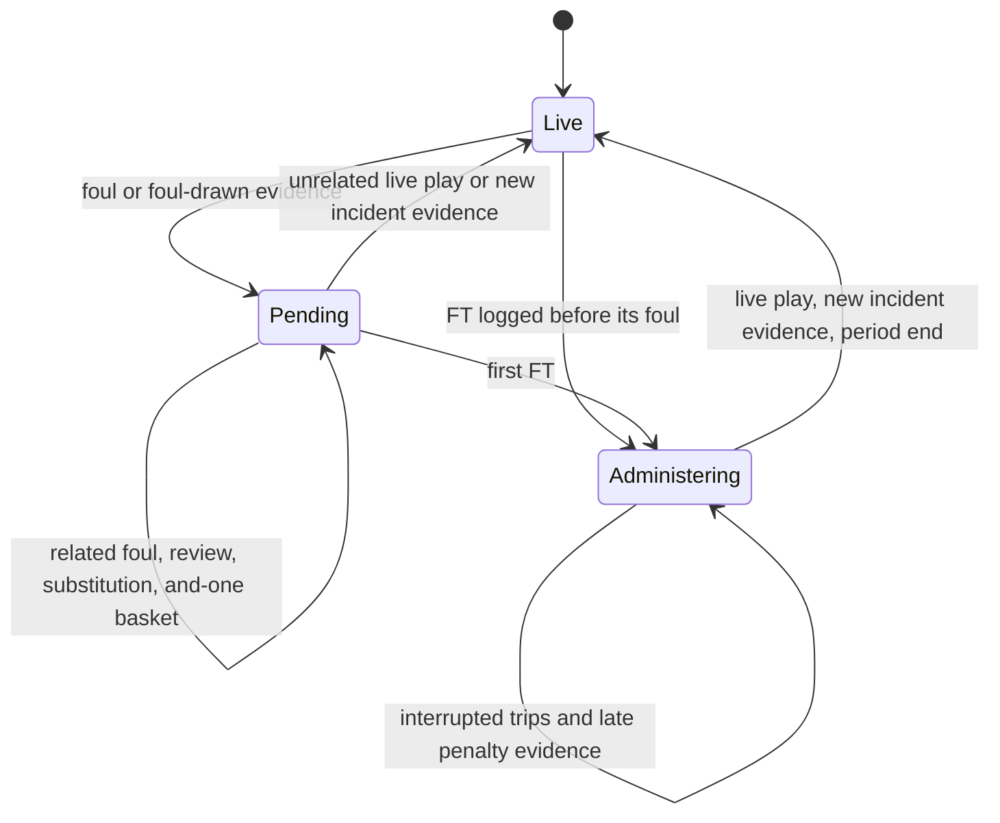

# Experimental FT state machine — 2026-11-17

Implemented alongside the canonical parser in
`euroleague/src/euroleague_possessions/ft_stoppages.py`. The ETL, loader, parser
version, R implementation, database and application routing are unchanged.

## Coverage-loss review continuation

The fixed 163-row cohort is now tracked in the
[incident review register](euroleague_ft_review_register_2026-11-17.md), with a
checked-in metadata seed, full source windows in ignored diagnostics, and
explicit evidence requirements. That register and the latest `summary.json`
supersede the initial counts below.

The final review replay completed **786 games / 32,731 FT rows** without errors.
It recovers unique provisional assignments for **60 of the original 163 rows**:
48 through incident-boundary corrections and 12 through joint personal-foul/RV
pairing. **There are no new coverage losses outside the original cohort.**

| Original cohort disposition | FT rows |
|---|---:|
| Recovered unique provisional candidate | 60 |
| Replacement condition requires evidence | 53 |
| Competing personal-foul assignments | 27 |
| Other unresolved shooter/award/boundary evidence | 23 |

Those last 23 comprise 11 shooter/fouled-player mismatches, three single
personal-foul FTs without a linked made basket, two excluded baseline parents,
two basket/award questions and five other shooter/award/scope questions. The
register preserves each incident and the evidence needed; these are triage
categories, not provider-error verdicts.

Across all FTs the final statuses are 32,357 unique candidates, 256 ambiguous,
83 possible replacements and 35 no-fit. Of baseline-confirmed FTs, 30,317 have
unique candidates and 103 remain withheld. Canonical trip partitions still
differ on the same 10 FT rows across four games; nine partial FT-endpoint
differences remain. Nothing has been promoted into production.

General refinements made during the review:

- Keep an unpaired foul-drawn row available across a clock difference when
  no intervening evidence identifies a different player/incident.
- Carry a recent made basket into a new foul incident when the new foul
  matches that basket's clock and opposing team, instead of discarding the
  basket with an older pending foul. The subsequent RV still constrains the
  shooter; clock alone does not establish the trip.
- Enumerate one-to-one personal-foul/RV pairings jointly with FT allocation.
  A single RV source row cannot identify two fouls. Equivalent assignments
  are deduplicated; distinct supported FT assignments remain ambiguous.
- Preserve two concrete FT allocation alternatives in `shadow_alternatives`
  for ambiguous incidents.
- Flag possible replacement shooters before the first attempt as well as
  between attempts; their rule condition still requires evidence.

Twenty focused tests pass. New labelled excerpts cover E2025/104's clock-shifted
and-one, E2025/116's joint pairing and E2025/171's basket transfer. The full
Python run has 324 tests with the same two unrelated SQL-test issues listed
below; all three required R regression scripts pass. The experimental/R
divergence remains deliberate; canonical behavior is unchanged.

## Initial offline replay (before coverage-loss review)

All **786 cached games / 32,731 FT rows** completed without errors. The final
manifest hashes match the current source and all per-game checkpoints.
This is the local cached population, not the older handoff's 819-game DB snapshot.

| Population | Games | FT rows | Unique candidate | Ambiguous | No fit | Replacement evidence required |
|---|---:|---:|---:|---:|---:|---:|
| EuroLeague | 499 | 19,628 | 19,371 | 154 | 101 | 2 |
| EuroCup | 287 | 13,103 | 12,926 | 114 | 59 | 4 |
| Total | 786 | 32,731 | 32,297 | 268 | 160 | 6 |

Unique candidates cover **98.7% of FT rows**. This denominator differs from
the earlier clock-bucket feasibility experiment. Every candidate is provisional.

| Baseline status | Unique candidate | Ambiguous | No fit | Replacement evidence required |
|---|---:|---:|---:|---:|
| Confirmed | 30,257 | 39 | 121 | 3 |
| Provisional | 2,029 | 229 | 35 | 0 |
| Unresolved | 11 | 0 | 4 | 3 |

The model therefore provides candidates for 11/18 original unresolved FTs and
2,029/2,293 provisional FTs, while losing unique assignment for **163 currently
confirmed FT rows**. Those losses are a publication blocker, not evidence that
all 163 baseline decisions were wrong.

Individual FT partitions differ on 10 rows across four games:

- **E2025/188:** Morris's interrupted three-shot personal trip becomes one trip.
- **E2025/355:** Milutinov's interrupted two-shot personal trip becomes one trip.
- **U2025/2:** Taylor's interrupted three-shot personal trip becomes one trip.
- **E2025/367:** two Dubrovnik FTs become one personal trip under an opposing
  technical-cancellation hypothesis. This remains explicitly flagged for review.

Candidate parents differ for 440 FT rows across 160 games. This includes changes
to incident/parent anchoring without changing FT membership; do not interpret
that number as 440 independently established fixes.

Of 30,377 FT rows with a non-null candidate endpoint, nine differ from baseline:
E2025/188 rows 218/223, E2025/355 rows 269/273, E2025/383 row 408,
E2026/44 row 242, U2025/125 row 522, U2025/2 row 345, U2026/20 row 367.
These are partial FT-end comparisons; they are not a validated net change in
game possessions, because made-basket suppression and non-FT ends must also be
integrated and reconciled.

The original unresolved FTs still without candidates are E2025/98 row 377,
U2025/86 row 466, U2026/56 row 458 and U2026/6 row 427. Replacement evidence is
required for E2026/31 row 372, U2025/79 row 58 and U2026/109 row 139; their
first attempts are also withheld, accounting for six affected FT rows overall.

## What the implementation does

`infer_ft_stoppages(events)` is a pure transformation. It normalizes using the
existing parser contract, preserves caller row order and canonical columns,
and adds `shadow_*` columns. It processes each game/period independently.



The state machine proposes incident windows. A separate bounded constraint
search assigns **individual FT rows** to foul entitlements. It considers
personal awards of zero/two/three, or zero/one for a matching and-one basket;
one-shot technical/coach/bench/throw-in penalties; and explicitly uncertain
contact/disqualification awards. Foul-drawn evidence constrains shooters.
There are no row-distance scores, clock-based incident IDs, or game-specific
exceptions in the implementation.

- A personal trip can resume after another player's technical FT.
- A matching and-one basket can be logged before or after its foul. An
  and-one basket appearing after an opposing technical FT is retained with
  an ordering warning.
- A bench foul can be logged after its FT.
- Different clocks can occur within one candidate incident. A new contact
  foul or different fouled player at another clock also provides evidence
  that an older, nonshooting incident has ended. Orphan RV rows cannot carry
  a new foul across that boundary.
- Rebounds logged after a foul but before its FTs, and possible penalty
  turnovers, are retained as flagged boundary hypotheses.
- A narrow opposing-technical cancellation candidate requires two opposing
  one-shot technicals at one clock, with no FT between them. It stays flagged;
  this does not implement the full special-situations rule.
- A shooter OUT followed by a replacement IN between attempts is detected.
  It does not authorize replacement without evidence of the rule condition.

## Output and uncertainty

`shadow_status` is `unique`, `ambiguous`, `no_fit`, `search_limit`, or
`replacement_requires_evidence`. Every `unique` assignment still has
`shadow_grouping_status = provisional`; every unsolved assignment is unresolved.
No canonical `grouping_status` is upgraded.

Unique candidates expose incident ID, foul source order, parent source order,
trip ID, attempt number, inferred trip size, and transition/warning trace.
And-ones use the made basket as parent and retain the foul identity separately.
The trip ID is based on the incident and foul, so a technical interruption
does not split the personal trip. Multiple trips by one shooter are enumerated
at the attempt level; if their FT membership is not unique, all affected trip
fields stay null. Exhausting the search budget never means unique.

`shadow_ft_end_poss` is a **partial FT endpoint candidate**, not a complete
possession stream. It is nullable for unsolved trips, uncertain foul/shooter
evidence, uncertain boundaries/cancellations, and retained-penalty sequencing.
For otherwise supported candidates it identifies the ordinary final make or
the final miss followed by observed rebound control/period end. Special-penalty
FTs do not end a possession. `shadow_suppressed_basket_order` identifies a made
basket whose end would move to its and-one FT. Non-FT endpoint recomputation,
complete possession ownership and reconciliation remain future integration work.

## Rule references and deliberate R divergence

The [2024 FIBA rules](https://assets.fiba.basketball/image/upload/documents-corporate-fiba-official-rules-2024-v10a.pdf)
(42.2, 43.2) and [2026 FIBA rules](https://assets.fiba.basketball/image/upload/documents-corporate-fiba-official-rules-2026-v1-1.pdf)
(36.3, 43.2, 44.2) support separating technical interruptions, cancellation
timing and replacement-shooter conditions. Both technical categories retain
a one-FT penalty in 2026. A substitution row alone does not establish injury,
five fouls or disqualification. These references are a rule basis, not evidence
that an individual provider sequence was correct.

This experimental interface deliberately differs from the R reference: it
returns provisional hypotheses and nulls instead of forcing every trip into
the canonical output contract. All existing labelled **FT partitions** match.
Parent parity is not claimed: for example the older dead-ball-foul fixture
E2025/54 attaches two FTs by a different player to a preceding made basket;
the shadow model retains the foul parent and does not suppress that basket.
The R implementation remains unchanged until a canonical design is selected.

## Initial validation

The initial version's fourteen focused tests passed, including every existing labelled FT partition,
source ordering, period separation, immutable input/canonical fields, bounded
search uncertainty, replacement evidence, cancellation after administration
has started, null endpoints with insufficient shooter evidence, and exact
checkpoint/baseline-reuse parity.

New manually labelled source excerpts in
`euroleague/tests/fixtures/ft_stoppage_reordered.csv` cover E2025/91's two
delayed and-ones and E2025/355's interrupted personal trip. Synthetic cases
also cover three-shot personal trips interrupted by technical FTs.

The initial broader Python run executed 318 tests with two failures in unchanged
areas, reproduced independently without the shadow tests:

- `test_apply_051_israeli_four_factors_minutes`: the measured candidate and
  production SQL bodies differ (`own_starters` versus `credit_own_starters`).
- `test_player_dashboard_reader`: its return-column extraction fails on the
  current Israeli SQL definition.

All three required EuroLeague R regression scripts passed, with environment
locale warnings. No UI changed; phone-layout verification is not applicable.

## Reproduce

```powershell
& euroleague/.venv/Scripts/python.exe -m unittest discover -s euroleague/tests -p test_ft_stoppages.py -v
& euroleague/.venv/Scripts/python.exe euroleague/scripts/compare_ft_stoppages.py
```

The comparison writes per-game checkpoints, `ft_rows.csv`, `differences.csv`,
`manifest.json` and `summary.json` under the ignored
`euroleague/data/diagnostics/ft_stoppage_shadow/`. Input and implementation
hashes invalidate stale results. Canonical FT decisions are reused only if
their input and parser/model/collector hashes still match; shadow inference
always processes all raw events again.

## Publication gate

Do not promote this module into the loader yet. Remaining work includes
reviewing losses of coverage against confirmed baseline trips, resolving
supported shooter replacements, validating special-penalty details, and
integrating a complete endpoint stream. Then perform score/possession
reconciliation before considering any reload. No production writes were made.
